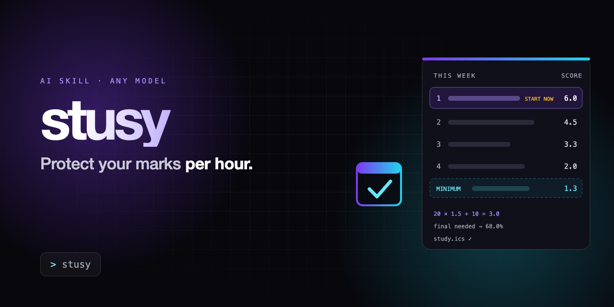

<p align="center"></p>

# stusy

A study secretary for your AI. It reads your syllabuses and tells you what to do first this week.

## How it works

| Step | You do | You type, for example |
|---|---|---|
| **1** | Type stusy. | `stusy` |
| **2** | Tell it your name and how many courses you take. | `Alex, 2` |
| **3** | Upload each course's syllabus when it asks, and check the deadline table. | *attach* `syllabus.pdf`, then `ok` or `Lab report 2 is 10%` |
| **4** | Look over your calendar of every date. Then upload each course's lecture notes and other documents. | *attach* `slides.pdf` *and* `exam-guide.pdf` |
| **5** | Answer five quick questions. Get your plan. | `Mon 2 Nov, Singapore, 18 hours` |

That's it. Every message it sends you starts with your name.

You get every date on a calendar you can read in the chat, then your week ranked by what protects the most marks, what you can do the minimum on, the mark you need on your finals, and a calendar file with every deadline.

## Get it into your AI (step by step, no GitHub account needed)

Never used GitHub? That's fine. You don't need an account, and you don't need to install anything from this page. You only copy one block of text, or download one file.

**First, pick your route:**

| You use | Your route | Takes |
|---|---|---|
| ChatGPT, Gemini, Perplexity, Copilot, Claude on the website or app, or any other AI chat | **[Route A](#route-a-copy-and-paste-any-ai-chat):** copy and paste one prompt | 1 minute |
| Claude Code | **[Route B](#route-b-claude-code):** download `SKILL.md` and put it in your skills folder | 3 minutes |
| Codex | **[Route C](#route-c-codex):** same as Route B, different folder | 3 minutes |

Not sure which one you use? Take **Route A**. It works in any AI chat.

### Route A: copy and paste (any AI chat)

1. Click [`PORTABLE.md`](PORTABLE.md). A new page opens.
2. Scroll down to the **grey box** that starts with `You are my study secretary`.
3. Copy the whole grey box:
   - **Computer:** move your mouse over the grey box. A small **copy icon** (two overlapping squares) appears in its top right corner. Click it.
   - **Phone:** press and hold inside the grey box, choose **Select All**, then **Copy**.
   - Copy only the grey box, not the instructions above it.
4. Open your AI and start a **new chat**.
5. Paste (**Cmd + V** on Mac, **Ctrl + V** on Windows, or press and hold, then **Paste** on a phone) and send it.
6. It replies "Hi! I'm stusy" by itself. If it summarises the text instead, type `stusy` and send. Answer its questions, and upload your files when it asks.

**Upload or paste ONLY the grey box (or only `SKILL.md`). Don't upload the whole folder:** it contains fictional example students, and some AIs mistake them for you.

**Keep it for next time** (so you only type `stusy`):

| Your AI | Where to paste the grey box once |
|---|---|
| ChatGPT | Make a **Project**, open its settings, paste into **Instructions**. Chat inside that project. |
| Gemini | **Gems** → **New Gem** → paste into **Instructions** → **Save**. Chat with that Gem. |
| Perplexity | Make a **Space**, paste into its **instructions**. Ask inside that Space. |
| Claude (website or app) | **Projects** → **New project** → paste into **Project instructions**. Chat inside that project. |

Menu names change from time to time. If you can't find them, or it says the text is too long, just paste the grey box at the start of each new chat. That always works.

### Route B: Claude Code

**Step 1. Download the skill file**

1. Click [`study_easier/SKILL.md`](study_easier/SKILL.md). A new page opens showing the file.
2. Look at the top right of the file, just above its text. There's a row of small buttons: **Raw**, a copy icon, and a **download icon** (an arrow pointing down). Click the **download icon** (its label is "Download raw file").
3. The file lands in your **Downloads** folder. Check that it's called exactly `SKILL.md`:
   - If it's called `SKILL.md.txt` or `SKILL (1).md`, rename it to `SKILL.md`.
   - Mac hides file endings. To see the full name, right click the file → **Get Info** → **Name & Extension**.

   No download icon? Click **Raw**, then press **Cmd + S** (Mac) or **Ctrl + S** (Windows), name it `SKILL.md`, and save it in **Downloads**.

**Step 2. Put it in your skills folder**

Claude Code looks for skills in a hidden folder. The easiest way to put the file there is to paste one line.

- **Mac:** press **Cmd + Space**, type `Terminal`, press **Enter**. Paste this line and press **Enter**:

  ```bash
  mkdir -p ~/.claude/skills/study_easier && mv ~/Downloads/SKILL.md ~/.claude/skills/study_easier/
  ```

- **Windows:** press the **Start** key, type `PowerShell`, press **Enter**. Paste this line and press **Enter**:

  ```powershell
  New-Item -ItemType Directory -Force "$HOME\.claude\skills\study_easier" | Out-Null; Move-Item "$HOME\Downloads\SKILL.md" "$HOME\.claude\skills\study_easier\"
  ```

If nothing prints, it worked. Error messages mean the file isn't in Downloads or isn't named exactly `SKILL.md`. Go back to Step 1, point 3.

**Step 3. Use it**

Close Claude Code and open it again (skills load when a session starts). Type `stusy`.

### Route C: Codex

Do Route B, Step 1. Then paste this instead of the Step 2 line:

- **Mac:**

  ```bash
  mkdir -p ~/.agents/skills/study_easier && mv ~/Downloads/SKILL.md ~/.agents/skills/study_easier/
  ```

- **Windows:**

  ```powershell
  New-Item -ItemType Directory -Force "$HOME\.agents\skills\study_easier" | Out-Null; Move-Item "$HOME\Downloads\SKILL.md" "$HOME\.agents\skills\study_easier\"
  ```

Open a new Codex session and type `$study_easier`.

### Want every file?

You don't need this to use the skill. If you want the examples and tests too, click the green **Code** button at the top of this page, then **Download ZIP**, then double click the downloaded file to unzip it.

### Stuck?

| Problem | Fix |
|---|---|
| It doesn't ask for your name and number of courses after you type `stusy` | Start a new chat and paste the grey box again. Make sure you copied all of it. It ends with `skip the questions it answers.` |
| Claude Code doesn't react to `stusy` | Check that the file is called `SKILL.md` (capital letters), in a folder called `study_easier`, inside `.claude/skills`. Then restart Claude Code. |
| It thinks I'm the example student (calls me Alex, or lists GEOG 105 / PHYS 120) | You uploaded the whole folder. Start a new chat and upload only `SKILL.md`, or paste only the grey box. |
| It just summarised the file instead of starting | Type `stusy` and send. |
| A file won't upload in the chat | See the upload tips below. |

**Upload tips**

- Upload **one course at a time**, when it asks.
- PDFs work almost everywhere. If a PowerPoint file won't upload, save it as PDF first.
- If a file won't upload at all, copy the syllabus's grading table and paste it as text.
- **Some courses don't allow AI tools.** Check your course's AI policy before uploading its materials.

## What you get

- **This week:** every deadline ranked by marks at stake per hour, with the sums shown so you can check them.
- **Topic split:** your exam revision hours split across the lectures the exam covers.
- **Do first:** at most three things, each with what to do in the first 25 minutes.
- **Safe to do the minimum:** low-value work with a clear minimum that keeps most of the marks. Compulsory, pass/fail and attendance items never go here.
- **Final needed:** the mark you need on the rest of the course to hit your target, or a plain "not reachable" with your best possible grade.
- **Calendar in the chat:** every deadline on a month-by-month calendar, shown before it asks for your notes.
- **Calendar file:** every deadline as a `.ics` file with a 24-hour reminder, for Google Calendar, Apple Calendar or Outlook.

- **Revision mode:** after the plan, type `revise`. It explains a lecture, answers questions, or quizzes you five questions at a time, using only the notes and slides you uploaded, and says which lecture each answer comes from.

It never does graded work for you: no assignments, problem sets, quiz or test answers, essays or reports.

See [`examples/guided-session.md`](examples/guided-session.md) for a full session, from the word `stusy` to the finished plan.

## Design rules

- It asks one thing at a time: syllabuses first, then your calendar, then your notes. It checks every course's deadline table with you before it plans.
- It never invents a date or a weight. Anything missing is marked `not in syllabus`, and it asks you.
- Minimum, never skip. Low-value work gets a defined minimum, not a deletion.
- Compulsory, pass/fail and attendance items are never minimised, even when they're worth 0%.
- Every number is shown as a sum you can redo.
- It asks for today's date instead of guessing it.
- It never promises a better grade.

## How it ranks

```text
urgency = 3 (due in 0–1 days) · 2 (2–3) · 1.5 (4–7) · 1 (8–14) · 0.5 (15+)
stake   = % of course grade × (course credits ÷ 3)
score   = stake × urgency ÷ hours
```

A big item can score low per hour and still need starting today, so there is a **START NOW** check: if the hours it needs, spread over your daily study time, run past the deadline, it goes to the top whatever its score. Deadlines inside the week get hours before later ones.

Ranking is a heuristic. Check it against your syllabus.

## What is in this repo?

| File | Use it for |
| --- | --- |
| [`study_easier/SKILL.md`](study_easier/SKILL.md) | The complete skill, written for Claude Code. |
| [`PORTABLE.md`](PORTABLE.md) | One copy-paste prompt for any AI chatbot. |
| [`examples/`](examples/) | Real runs on fictional courses: the full guided flow, a busy week, and an exam week. |
| [`tests/`](tests/) | The rubric, fictional syllabuses and slides, every raw run, the results, and `verify.py`, which recomputes every number and checks the calendar file. |
| [`assets/`](assets/) | The banner and its HTML source. |

## How it was tested

Two fictional courses with real PDF syllabuses and slides, one of them missing a weight on purpose, were run through the full guided flow twice: once with the skill, once with the portable prompt and skills turned off. Both runs asked for the courses first, took the files one course at a time, confirmed each table, asked about the missing weight instead of guessing, and produced a plan that `verify.py` checked number by number. Earlier single-message tests also compared the skill with a plain AI answer. The results were self-scored by the same AI on a small sample, and only Claude was tested: see [`tests/results.md`](tests/results.md). These tests ran on the earlier flow (trigger `study`, syllabus and slides together, no name). The current `stusy` flow has not been re-tested yet.

## Licence

MIT. See [`LICENSE`](LICENSE).
